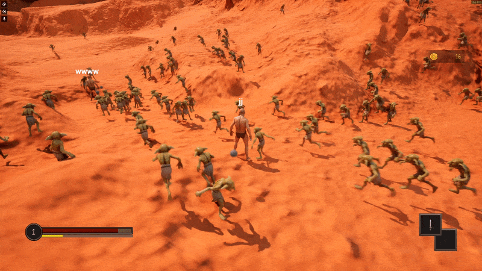
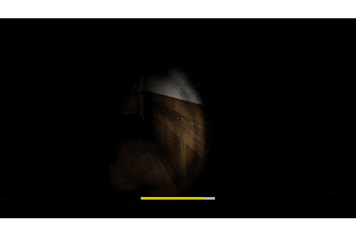
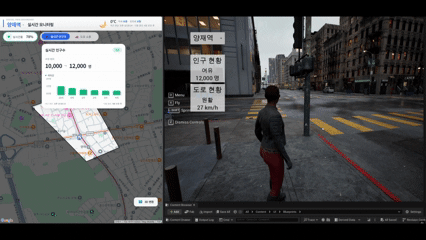

# 💼 포트폴리오

> **"클라이언트 프로그래머 심조운 입니다."**  

 

##  Tech Stack
| **Languages** |   |
| :--- | :--- |
| **Engines** |  |
| **Tools** |  |

 

## 📄 Projects

### 1. Project_Nayuta (사이드 프로젝트)
> **요약 :** "언리얼 엔진을 사용한 멀티(리슨) 로그라이크 게임"

| Preview & Info |
| :---: |
|  |
|  **개발 기간 :** `2026.05 ~ 진행중`   **인원 :** `1명`   **사용 기술 :** `UE5`, `C++`, `Steam OSS`   **Repository :** [링크](https://github.com/1frbottom/UE5_Project_Nayuta)   **유튜브 :** [링크](https://youtu.be/VkQyTnjKNqA)   |

#### 핵심 기여
1. 대규모 몬스터 처리 구조  
    - Object Pool, `NetDormancy`, 몬스터전용 `UPawnMovementComponent`로 부하와 이동 동기화 문제를 해결.  
2. 서버 권위 멀티플레이 구조  
    - 서버: 전투-웨이브-보상 판정 처리, 클라이언트에게 받은 RPC로 행동 요청을 검증.  
    - 클라이언트: 공격, 보상 선택 등의 행동은 Server RPC로 요청만 전송. 이동은 CMC 예측 기반이며, 스프린트의 속도 변경도 `SavedMove`에 실어 서버가 재계산시에도 동일하도록 구성.  

#### 트러블슈팅

<ul>

 대규모 몬스터 처리 부하 및 이동 동기화 <em>—( click )</em>

 

>**문제 상황 :**
>
>- `800`마리 스폰 테스트에서 프레임타임이 마릿수에 비례해 급증하여 스터터링 발생.
>
>  
>
>**원인 분석 :**
>
>- 매 스폰 `SpawnActor()` → 할당/GC 부하.  
>- 이동 Sweep, 피격 오버랩, 체력바 위젯이 마릿수에 비례.  
>- `ReplicateMovement`로 트랜스폼을 전부 동기화하며 대역폭 포화.
>
>  
>
>**해결 과정 :**
>
>- 1차 (2026.05) : 풀링으로 런타임 스폰 제거. Sweep OFF, 피격은 distance로 판정, 체력바는 Material CPD로 교체. 프레임타임 `40ms` 구간까지 방어.  
>- 2차 (2026.06) : 이동 복제를 끄고, 활성화 시점에 시드·타겟·스폰 위치만 복제해 각 머신이 같은 이동을 직접 계산. 대기 중인 몬스터는 `NetDormancy`, 먼 몬스터는 `NetCullDistance`로 복제 제외.  
>- 3차 (2026.08) : 기존에는 평지로 테스트했기 때문에 경사 처리 필요, 기존 무거운 이동컴포넌트 대신 바닥 추적·스텝업만 가진 전용 `UPawnMovementComponent`로 해결하고, `ShouldTick()`으로 불필요한 틱 차단.  
>- 4차 (2026.11) : 2차 이후 몬스터 위치를 머신마다 직접 계산, 머신마다 플레이어와 겹친 몬스터가 밀려난 위치가 달라짐. 실제 캡슐은 그대로 두고 메시만 살짝 밀려 보이게 변경.
>
>  
>
>**프로파일링 [영상](https://youtu.be/UQ7nFVs-mc0)** :
>
>- 2026.08 / Steam OSS 리슨, 기기 2대, 클라 측정  
>
>- 처리 부하 : 
>   - 몬스터 `100`마리 프레임타임 `7.46ms` → `800`마리 `30.84ms` (`32 FPS`).  
>   - GPU타임 `5.24ms` → `6.13ms`로 유지.  
>   - 게임 스레드 `30.89ms`로 프레임타임과 일치 → 병목은 렌더가 아닌 게임 스레드(Tick/로직).  
>- 네트워크 :
>   - 액터 수 8배 증가에도 손실 없이 패킷당 크기 약 `128B` 유지.
  

 클라이언트 위치 보정 (러버밴딩) <em>—( click )</em>

 

>**문제 상황 :**
>
>- 클라이언트에서 스프린트 or 몬스터와 겹칠시 플레이어가 이전위치로 튀는 현상 발생.
>
>  
>
>**원인 분석 :**
>
>- 기존 CMC는 클라이언트가 입력으로 먼저 움직이고, 서버 시뮬과 다르면 위치를 보정함.  
>- 스프린트: 속도 변경이 이동 패킷(`SavedMove`)에 없고 PlayerState 복제 타이밍에만 맞춰져, 잠깐이라도 서버·클라간 속도가 다르게 됨.  
>- 몬스터 겹침: 분리를 서버에서만 `SafeMoveUpdatedComponent()`로 처리해, 클라 예측 경로에 그 이동이 없었음.
>
>  
>
>**해결 과정 :**
>
>- 스프린트 여부를 `SavedMove` 커스텀 플래그로 보내고, `GetMaxSpeed()`에서 양쪽이 같은 속도를 쓰게 함.  
>- 몬스터로부터 밀어내는 처리는 `AddMovementInput()`으로 처리해 서버도 같은 입력을 재생하도록 함.

</ul>

 

### 2. Horror (사이드 프로젝트)
> **요약 :** "언리얼 엔진을 사용한 싱글 인도어 호러게임"

| Preview & Info |
| :---: |
|  |
|  **개발 기간 :** `2025.03 ~ 2025.09`   **인원 :** `2명` ( 1 Designer, **`1 Programmer`** )   **사용 기술 :** `UE5`, `C++`   **Repository :** [링크](https://github.com/1frbottom/UE5_Horror)   **유튜브 :** [링크](https://youtu.be/4RwZF5kehHY)   |

#### 핵심 기여
1. 인터페이스 기반 상호작용 시스템  
    - 플레이어는 인터페이스로만 실행 요청해 문·서랍·아이템 BP와 결합도를 낮춤.  
    - 근접 감지·시선 판정·외형 콜리전을 분리하고 전용 트레이스 채널을 두어, 가려진 물체의 판정 문제를 해결.  
2. `AIPerception`, `Behavior Tree` 기반 고스트 AI  
    - 시각·청각 감지를 `Blackboard`에 갱신해 추적 → 소리 확인 → 순찰로 전환.  
    - 공격 `BTTask`를 애니메이션 종료 델리게이트로 끝내 행동이 겹치지 않도록 동기화.  

 

### 3. 디지털트윈 데이터 파이프라인 (교내 프로젝트)
> **요약 :** "디지털트윈을 위한 실시간 공공 교통데이터 동기화 파이프라인 및 가시화"  아래 프리뷰의 우측은 UE5 오픈소스 프로젝트인 `City Sample` 위에 해당 프로젝트 파이프라인을 얹은 모습입니다. 

| Preview & Info |
| :---: |
|  |
|  **개발 기간 :** `2025.09 ~ 2025.12`  **인원 :** `4명` ( **`2 Backend`**, 2 Frontend )   **사용 기술 :** `Python`, `Kafka`, `Spark`,  `PostgreSQL`, `Docker`, `UE5`    **Repository :** [링크](https://github.com/1frbottom/DigitalTwin_PipeLine)   **유튜브 :** [링크](https://youtu.be/kguMl6Y8WFU)   |

#### 핵심 기여
1. 프로젝트 인프라 구축  
    - `Docker Compose`로 Kafka·Spark·PostgreSQL 등 10개 서비스 구성, `healthcheck`와 `depends_on` 조건으로 토픽 생성 완료 후 Spark가 구독하도록 기동 순서 보장.  
2. 데이터 파이프라인 구현  
    - `Spark Structured Streaming`으로 중첩 JSON 도시데이터를 `from_json()`·`explode()`로 평탄화해 인구·도로·기상 등 섹션별 테이블로 분기 적재.  
3. UE5 가시화 (오픈소스)  
    - 수집된 실시간 교통·인구 데이터를 오픈소스 샘플 내 차량·보행자 스폰 밀도로 연동해 가시화.  
    - 기본 AMassSpawner를 상속해 재스폰 함수를 구현, 기존 Spawner BP를 reparenting 하여 런타임 스폰 수를 변경 가능하도록 수정.  
    - VaRest 플러그인으로 API 데이터를 받아 스폰 개수를 동적으로 조절.  

#### 트러블슈팅

<ul>

 공공데이터 JSON 구조 불일치 및 파싱 오류 <em>—( click )</em>

 

>**문제 상황 :**
>
>- 공공데이터 API 응답 일부가 Spark에서 null로 파싱되어 누락되고, API 서버에서는 타입 변환 예외 발생.
>
>  
>
>**원인 분석 :**
>
>- Spark : 같은 섹션이라도 응답에 따라 `$.A.A`(래퍼 태그 중첩) 또는 `$.A`로 계층 경로가 달라져, 고정 경로로 `from_json()` 파싱 시 null 반환.  
>- 백엔드 : 특정 필드가 누락되거나 빈 문자열로 들어올 때 정수 변환에서 예외 발생.
>
>  
>
>**해결 과정 :**
>
>- Spark : `get_json_object()`로 후보 경로를 각각 추출한 뒤 `coalesce()`로 존재하는 값을 우선 선택.  
>- 백엔드 : 헬퍼 함수 `get_val()`을 구현해 필드 누락 시 대체 필드를 조회하고, 없으면 기본값(0)을 반환하여 방어.

</ul>

 

## 📄 Other Projects
* **[UN6_VR_ZombieDefense](https://github.com/1frbottom/UN6_VR_ZombieDefense) :** 유니티, 메타 SDK 사용 간단 VR 디펜스 fps 게임

* **[Java_LibGDX_JumpKingLike](https://github.com/1frbottom/Java_LibGDX_JumpKingLike) :** 자바 LibGDX 사용 간단 2d 점프킹류 게임

* **[Java_Clone_Game](https://github.com/1frbottom/Java_Clone_Game) :** 자바 awt/swing 사용 간단 종스크롤 슈팅 모작 게임

